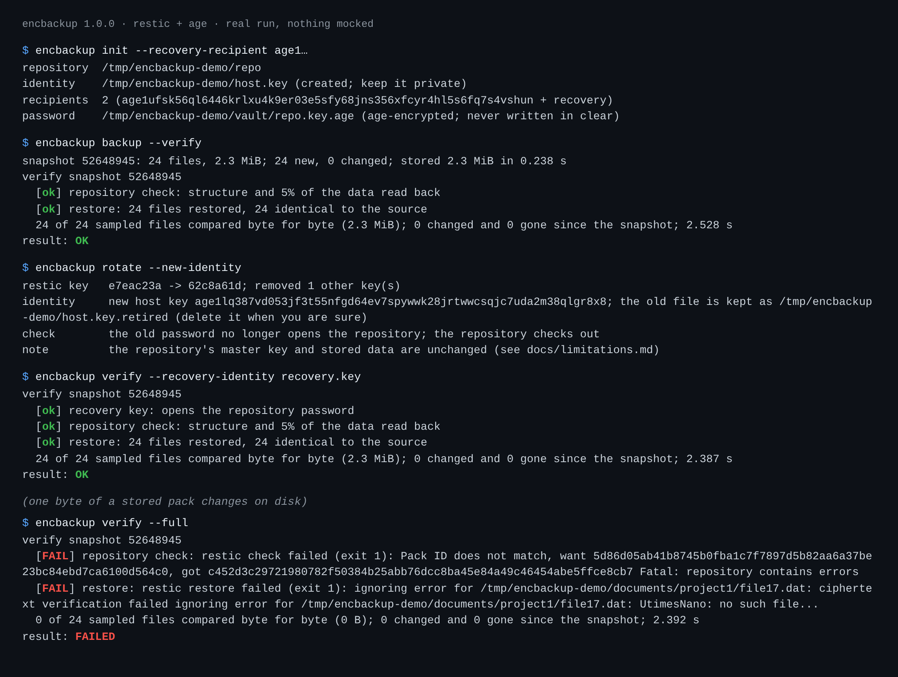

# encbackup: encrypted backups that are verified by restoring them

[](https://github.com/TexAlphaWolf/sec-encrypted-backup/actions/workflows/ci.yml)
[](https://github.com/TexAlphaWolf/sec-encrypted-backup/actions/workflows/codeql.yml)

A small wrapper around [restic](https://restic.net) (snapshots, deduplication, encryption) and [age](https://age-encryption.org) (keys) that does the parts a backup script usually leaves out: it keeps the repository password **only encrypted** to this machine's key *and* an offline recovery key, **rotates** keys in an order that survives a crash, and **proves the backup can be read back** by restoring a sample and comparing it byte for byte with the live files.



## Why

A backup that has never been restored is a hope. And a backup tool that needs a password in a file next to the data has moved the problem, not solved it. encbackup is the glue for three things restic and age leave to you:

1. **No password on disk in clear, and no single point of loss.** `init` generates a 384-bit password, creates the repository, and stores the password as an armoured age file encrypted to two recipients: this machine and a recovery identity you keep offline. Losing the machine does not lose the backups; `restore --identity recovery.key` works from a copy of the vault.
2. **Verification by restore.** `verify` reads back part of the stored data (`restic check`), restores a sample of files to a scratch directory (restic checks each against its own hashes), and compares every file that has not changed since the snapshot with its live source by SHA-256. If nothing could be compared, it fails instead of passing on nothing.
3. **Rotation that cannot strand you.** `rotate` adds the new restic key, stores the new password (encrypted to the old and new host key during an identity change, read back before it is trusted), swaps the identity file, removes the old keys, and proves the old password is refused. A crash at any step leaves a repository you can still open; the next rotation cleans up.

## Quick start

With Docker (restic and age are inside the image):

```bash
docker build -t encbackup .
docker run --rm --entrypoint age-keygen encbackup          # keep the secret key offline; note the public one
docker run --rm -v encbackup-state:/state -v "$PWD/documents":/data:ro encbackup init --recovery-recipient age1...
docker run --rm -v encbackup-state:/state -v "$PWD/documents":/data:ro encbackup backup --verify
```

Without Docker: install restic (0.16 or newer) and age, `pip install .`, copy [`examples/encbackup.toml`](examples/encbackup.toml), then `encbackup -c encbackup.toml init --recovery-recipient age1...` and `encbackup -c encbackup.toml backup --verify`. [`examples/`](examples/) also has a systemd service and timer and Prometheus alert rules.

| Command | What it does |
|---|---|
| `init --recovery-recipient KEY` | Create the identity, the password, the repository. Refuses to overwrite anything. |
| `backup [--verify]` | Back up the configured paths, then apply the retention policy. Exit 3 if some files could not be read. |
| `verify [--full] [--sample N] [--recovery-identity FILE]` | Check the repository, restore a sample, compare with the live files, optionally prove the recovery key. |
| `restore --target DIR [--include PATH] [--identity FILE]` | Restore into an empty directory; `--identity` for the recovery key on a new machine. |
| `rotate [--new-identity]` | New restic password; optionally a new age identity for this machine. |
| `status [--format text\|json\|prometheus]` | From the journal, no key needed. Exit 1 if the last backup is stale or failed, or the last verification failed. |

Exit codes: 0 fine, 1 a check failed, 2 error (configuration, missing program, wrong key), 3 incomplete backup.

## Measured

All from [`tools/evaluate.py`](tools/evaluate.py) with real restic 0.16.4 and age 1.1.1 ([full results](docs/evaluation.md), raw numbers in [`docs/report.json`](docs/report.json)):

- **Dedup and speed:** a second backup of unchanged data stored **362 bytes**; editing 3 of 60 files stored 314,144 bytes. age adds **2.8 ms** per command.
- **Damaged repositories** (one random byte changed, 40 trials): reading 5% of the data and restoring one file found it in **16 of 40**; restoring all files in **39 of 40**; reading all data (`verify --full`) in **40 of 40**. The one miss of the middle row was damage that only an *older* snapshot uses: a restore tests the newest one. Damage to index, snapshot and key files (outside the key's plain-text label) was found 20 of 20, 20 of 20 and 28 of 28 times.
- **Rotation:** 6 rotations in a row; the old password was refused **6 of 6** times and **0 of the 6 old passwords** open the repository at the end; `verify` passed after each; the recovery key always opened the current password.
- **Secrets at rest:** none of the 7 passwords the repository has had appears in any file outside it.

The defaults favour speed over certainty; [the evaluation](docs/evaluation.md) says how to choose.

## Security decisions

- The password is never on a command line and never on disk in clear; restic receives it in its own environment. No command runs through a shell. `RESTIC_PASSWORD`, `RESTIC_PASSWORD_FILE`, `RESTIC_REPOSITORY` and the like are removed from the environment so an ambient setting cannot redirect a run.
- An identity file readable by other users is refused, as ssh does. Files are replaced atomically (write, flush, rename). The temporary file used to add a restic key is 0600 in a 0700 directory and removed at once.
- Error messages are scrubbed of URL credentials (`rest:https://user:pw@host`) and age secret keys.
- Configuration is validated strictly: an unknown key or a wrong type is an error, never ignored.

[`docs/limitations.md`](docs/limitations.md) is worth reading: rotation does **not** re-encrypt the data (restic's master key is unchanged), a compromised host can still delete its backups unless the repository is append-only, and `verify`'s defaults sample rather than prove. Architecture and the rotation sequence: [`docs/architecture.md`](docs/architecture.md). Reporting a vulnerability: [`SECURITY.md`](SECURITY.md).

## Development

```bash
sudo apt-get install restic age
pip install -e ".[dev]"
ruff check . && ruff format --check . && mypy && pytest -n auto --cov
python tools/evaluate.py
tools/docker_e2e.sh            # needs Docker: the whole flow inside the image, read-only, no capabilities
# Windows PowerShell: .\tools\docker_e2e.ps1
```

Standard library only at run time. The tests use the real restic and age (no mocks); CI runs them on Python 3.11 to 3.14, runs the evaluation and fails on a wrong result, builds the image and runs the end-to-end flow in it, and runs CodeQL. Windows CI runs the tests that do not need restic and age.

## License

MIT - Luca Tessitore
