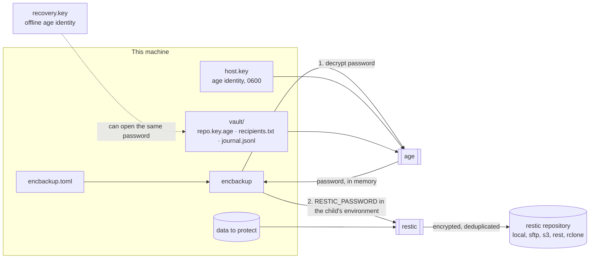

# Architecture



**One secret, two ways in.** `init` generates a 384-bit password, creates the repository with it, and stores it only as an armoured age file encrypted to two recipients: this machine's identity and an offline recovery key. Every command decrypts it with age and gives it to restic through the child's environment.

**Rotation order** (`rotate`), chosen so that a crash at any step leaves a repository that can still be opened:

```mermaid
sequenceDiagram
    participant E as encbackup
    participant R as restic
    participant V as vault
    E->>R: add new key (authenticated with the old one)
    E->>V: write new password, encrypted to old+new host key and recovery key; read it back
    E->>V: swap identity file (new identity in place, old one kept as .retired)
    E->>V: rewrite for new host key and recovery key only
    E->>R: remove every other key; prove the old password is refused
    E->>R: check
```

**Verification** (`verify`): recovery key opens the same password → `restic check --read-data-subset` → restore a sample into a scratch directory (`restic restore --verify` checks every file against restic's own hashes) → compare each unchanged file with its live source by SHA-256.
